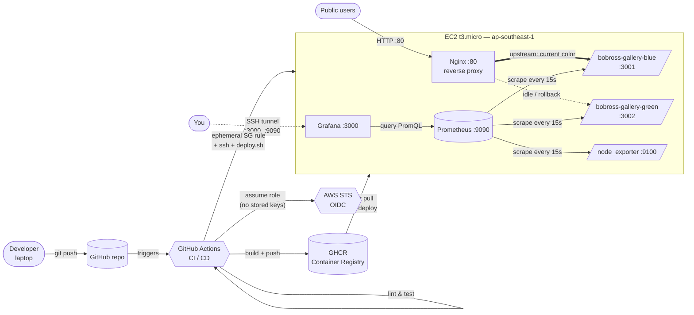

# Architecture

## High-level diagram



## Components

| Layer | Component | Purpose |
|---|---|---|
| **IaC** | Terraform | Provisions AWS: VPC, subnet, IGW, route table, security group, EC2, SSH key pair |
| **Config mgmt** | Ansible (from WSL) | SSH hardening, UFW, fail2ban, Docker install, Nginx install, apt mirror switch |
| **App** | Node.js + Express + prom-client | Serves Bob Ross gallery; exposes `/`, `/health`, `/metrics` |
| **Container** | Docker, multi-stage build, non-root user | Packages the app for identical dev + prod behavior |
| **Registry** | GHCR (GitHub Container Registry) | Hosts the built images; public, free, auto-authenticated via GitHub Actions |
| **CI** | GitHub Actions (`test` + `build-and-push` jobs) | Lints, tests, builds the Docker image on every push |
| **CD** | GitHub Actions (`deploy` job) | OIDC-federated AWS access; opens ephemeral SG rule; SSHes to EC2; runs `deploy.sh` |
| **Reverse proxy** | Nginx | Fronts both app containers; upstream swap for blue-green |
| **Deploy script** | `deploy/deploy.sh` on EC2 | Pulls new image, starts inactive color, health-checks, swaps Nginx upstream |
| **Rollback** | `deploy/rollback.sh` + `.github/workflows/rollback.yml` | Flips Nginx back to previous color; manual trigger in GitHub UI |
| **Monitoring** | Prometheus + Grafana + node_exporter (Docker Compose) | Scrapes app + host metrics; provisioned dashboard; one alert rule |

## Deploy flow (what happens on `git push`)

```mermaid
sequenceDiagram
    autonumber
    participant Dev as Developer
    participant GH as GitHub
    participant GHA as GitHub Actions
    participant GHCR as GHCR
    participant AWS as AWS STS
    participant SG as Security Group
    participant EC2 as EC2 (deploy.sh)
    participant NGX as Nginx

    Dev->>GH: git push main
    GH->>GHA: trigger CI workflow
    GHA->>GHA: lint &amp; test
    GHA->>GHCR: docker build &amp; push :latest, :sha-xxx
    GHA->>AWS: AssumeRoleWithWebIdentity (OIDC)
    AWS-->>GHA: short-lived credentials (1 hr)
    GHA->>SG: AuthorizeSecurityGroupIngress (runner IP → :22)
    GHA->>EC2: ssh ... bash < deploy.sh
    EC2->>EC2: detect current color (blue)
    EC2->>GHCR: docker pull :latest
    EC2->>EC2: start green on :3002
    EC2->>EC2: curl :3002/health (loop, max 10 attempts)
    EC2->>NGX: rewrite upstream → :3002, nginx -s reload
    NGX-->>Dev: live traffic now served by green
    EC2-->>GHA: deploy OK
    GHA->>SG: RevokeSecurityGroupIngress (always runs)
```

Zero-downtime because the old container keeps serving while the new one warms up and gets health-checked. Rollback = swap upstream back; the old container is still running on its port.

## Security choices

- **IAM least-privilege**: separate roles for Terraform (full EC2+VPC) and GitHub deploy (describe + SG ingress only)
- **OIDC federation**: no long-lived AWS keys stored in GitHub; GHA assumes a role trusted only from `donnieyennnnh/Blue-Green-Deployment@main`
- **Ephemeral SG rules**: SSH port opens only for the current runner's IP, only for the deploy's duration; revoked in `always()` block
- **SSH hardening**: no root login, no password auth, key-only (Ansible-enforced in `site.yml`)
- **UFW + fail2ban**: defense in depth alongside AWS SG
- **Non-root container**: app runs as uid 1000 inside the image
- **Monitoring bound to localhost**: Grafana + Prometheus never exposed to the public internet; access only via SSH tunnel
- **Secrets never in state**: SSH private key never written by Terraform; user generates and provides public key only

## Cost (ap-southeast-1, post-free-tier)

| Resource | Monthly |
|---|---|
| EC2 t3.micro | ~$9.50 |
| EBS gp3 8 GB | ~$0.80 |
| VPC / subnet / IGW / SG / key pair | $0 |
| GHCR (public image) | $0 |
| Data transfer out (small) | $0 (under free tier) |
| **Total** | **~$10/month** (or $0 during the 12-month free tier) |

Destroy anytime with `terraform destroy` → bill goes to $0 immediately.
